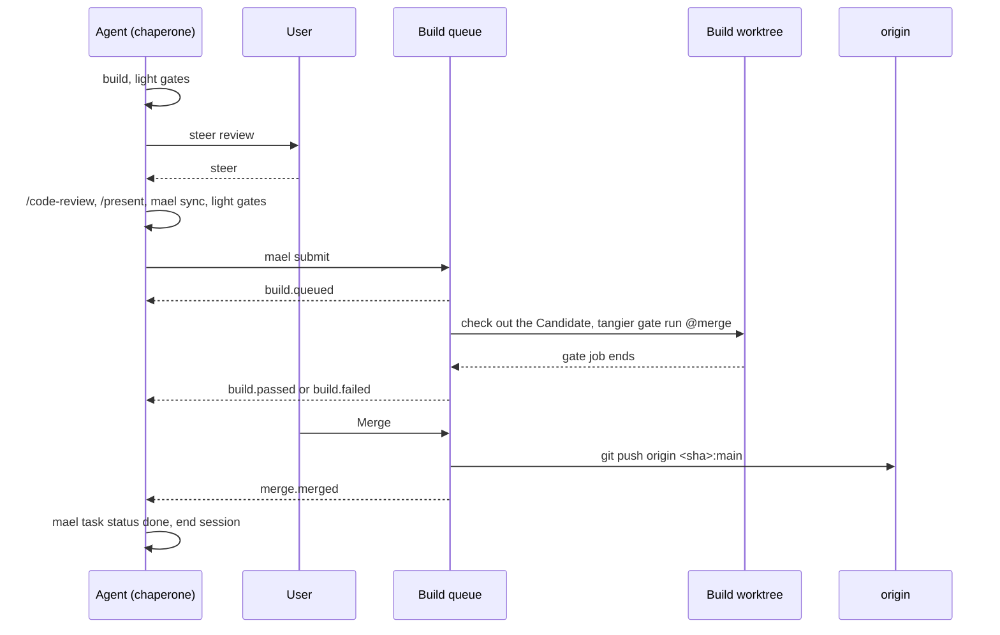

# The build queue

A project with `merge: local` in `.maelstrom.yaml` does not use pull requests. The agent submits
its branch head as a **Candidate**. The project's **Build queue** runs the full gate set on it in
a **Build worktree**. The user reviews a green Candidate and clicks Merge, and maelstrom
fast-forwards `main` on origin to it. GitHub stays a plain git remote.

[ADR 0004](../adr/0004-maelstrom-merges-through-a-local-build-queue.md) records the decisions
and the options rejected. This doc describes the mechanics that the chain after task q944
builds. A project with `merge: github`, the default, keeps the PR flow of [CI gates](ci.md).

## The flow

The flow has two human **Checkpoints** and one queue.

1. **Steer review.** After the `built` milestone, the agent runs the light gates and presents the
   branch for a rough steer. It waits for the user. Structure and behaviour change here, before
   review and present spend tokens on them.
2. **Submit.** After `/code-review` and `/present`, the agent runs `mael sync`, the light gates,
   and `mael submit`. The branch head becomes a Candidate.
3. **Build.** The queue checks out the Candidate in a build worktree and runs the full gates.
   A failure goes back to the agent, which fixes the branch and submits again.
4. **Final review and merge.** A `passed` Candidate draws the Merge button. A click
   fast-forwards `main` to the Candidate.

## Candidates

A Candidate is one commit: the branch head at submit. Its base is the `origin/main` tip at
submit. `mael submit` refuses a branch whose base is not the current `origin/main` tip. The
agent runs `mael sync` first.

`mael submit` pushes the branch, then records the Candidate on the task with its head SHA. The
queue gates that SHA. A commit after submit does not change the Candidate. The next submit
replaces it. `mael withdraw` takes the Candidate out of the queue.

`.drafts/pr.md` becomes the Candidate's description. The merge review shows it.

| State       | Meaning                                                                  |
| ----------- | ------------------------------------------------------------------------ |
| `queued`    | Waits for a free build worktree.                                         |
| `building`  | A gate job runs on it in a build worktree.                               |
| `passed`    | Every gate passed, and its base is the `main` tip. Merge is enabled.     |
| `stale`     | Its base is not the `main` tip. It must be rebased and submitted again.  |
| `failed`    | A gate failed.                                                           |
| `withdrawn` | The agent withdrew it, or a new submit replaced it.                      |
| `merged`    | `main` on origin is at its SHA, or contains it.                          |

The normal path is `queued → building → passed → merged`.

## The chaperone

Every Candidate has a **Chaperone**: the agent of the Candidate's task. The queue sends it each
`build.*` and `merge.*` event, and never changes the branch itself. All git work on the branch
stays with the agent.

When an event is due and the chaperone is not live, the orchestrator resumes the task's last
session, then sends the event. The task closes at merge, not at submit, so the chaperone stays on
the Candidate until `merge.merged`.

## Building

### The base check

A build checks its base when it starts. When `main` moved after submit, the queue does not build.
It sends `build.rebase` and the Candidate goes `stale`. The agent runs `mael sync`, resolves any
conflict, runs the light gates, and submits again.

### No rebuild when `main` moves

A merge does not touch the other Candidates. A `passed` Candidate whose base is no longer the
`main` tip shows `stale`. Its Merge button reads "Rebase and rebuild", and a click sends
`build.rebase` to the chaperone. Only a Candidate that a human wants to merge now builds again.

Records keep a rebuild cheap. A gate whose gate scope content did not change is `verified` at
once.

### Each Candidate is gated alone

A Candidate is gated against `main`, not on top of the Candidate before it. The queue sets no
merge order: a human picks it at the Merge button. ADR 0004 gives the reason.

### Build worktrees and slots

Each build checks out its Candidate in a build worktree from a pool: `_build1` … `_buildN`. A
build worktree is a maelstrom worktree that never closes, like `_main`. It has its own
`PORT_BASE`, its own `.env`, and runs the project's `install_cmd`.

`build_slots:` in `.maelstrom.yaml` sets N. The default is 2. Waiting Candidates build oldest
first. Tangier's machine-wide job slots (`max-running`, default 4) still cap every gate job on
the host, the agents' jobs included.

Before a build, the queue resets the build worktree to the Candidate SHA. It also removes
untracked files, so a failed build leaves nothing for the next one.

The state database keeps the Candidates. A Candidate that was `building` when the server stopped
goes back to `queued` at start. Records make its second build cheap.

### The gates and their weights

`pipeline.toml` stays the one place that defines a gate. Gate sets name two weights:

| Weight | Command                               | Who runs it            | When                         |
| ------ | ------------------------------------- | ---------------------- | ---------------------------- |
| Light  | `tangier gate run @pre-merge --direct` | The agent              | Before steer review, submit  |
| Full   | `tangier gate run @merge`              | The build queue        | Each build                   |

`--direct` makes a gate needed only when its own gate scope paths change, not those of a gate it
`depends` on. The full set has the `depends` cascade and `e2e`.

The queue runs with `TANGIER_RUNNER_KIND=queue`, so its records have the `queue` kind. The trust
rules are the same as for CI:

- `lint`, `test`, `web` and `jig` accept any local pass record.
- `e2e` accepts only a record with `kind=queue`: `accept = "kind=queue"`.

The queue's gate jobs are normal tangier jobs. The **Gate watch** sees them, and the build
worktree's node shows a **Gate lozenge**. The queue reads the end of each job from the Gate watch.

Until tangier ships gate sets, the queue runs an explicit gate list.

### The container runner

`[gate.<name>] container = "<image bucket>"` in `pipeline.toml` runs the gate's command in the
image of tangier's `[image.<bucket>]`, with the checkout mounted. A container isolates ports and
toolchains, so `e2e` can also run in an agent's worktree. Tangier owns the runner. Maelstrom's
own gates do not use it yet.

## Merging

The Merge button merges a `passed` Candidate, and is pinned to its SHA. A click starts one
**Operation**:

1. Fetch `origin/main`. When its tip is not the Candidate's base, mark the Candidate `stale` and
   stop.
2. `git push origin <sha>:main`, with no force.
3. Delete the remote branch.
4. Update `_main` with `update_local_main`.
5. Send `merge.merged` to the chaperone, which closes the task and ends its session.

A rejected push marks the Candidate `stale`, as a move of `main` does. Git rejects a push that is
not a fast-forward, so the push needs no lock.

After the push, the branch is in `main`, so `is_worktree_closed` and **Dismiss** need no change.

`mael git merge` goes through the queue in a `merge: local` project.

## Events

| Source  | Type            | Sent when                                         |
| ------- | --------------- | ------------------------------------------------- |
| `build` | `build.queued`  | The queue accepts a submit.                       |
| `build` | `build.passed`  | Every gate passed.                                |
| `build` | `build.failed`  | A gate failed. It names the gate and the log.     |
| `build` | `build.rebase`  | The base check failed, or the user clicked "Rebase and rebuild". |
| `merge` | `merge.merged`  | The push to `main` succeeded.                     |

The user's review comments reach the chaperone as `orchestrator-ui` events.

## Landing

The `merged` **Landing step** of a `merge: local` task reads the queue's record in the state
database, not GitHub's data about a PR. `uat` and `live` still come from the deploys that
`deploy.environments` names.

## Remote hosts

The build queue runs on the server that owns the project's tasks: the **Parent server**. An agent
on a **Remote host** submits through the parent, because its task stays there. `mael submit`
pushes the branch to origin first, so the parent's build worktree fetches it. Events to a remote
chaperone go through the parent's normal forward. See [remote hosts](remote-hosts.md).

## Code the chain reuses

| Code                                                    | Use                                     |
| ------------------------------------------------------- | --------------------------------------- |
| `merge_to_main` (`mael_domain/worktree.py`)              | The push to `main`, without its rebase. |
| `update_local_main`, `close_worktree`, `is_worktree_closed` (`worktree.py`) | `_main` after merge, Dismiss. |
| `register_pr`, `withdraw_pr` (`mael_domain/task.py`)     | The shape of submit and withdraw.       |
| `pr_events`, `gate_event` (`mael_domain/external_event.py`), `pr_ledger_store.py` | The `build.*` and `merge.*` events. |
| `gate_source.py`, `gate_table.py` (`mael_orchestrator`)  | The Gate watch.                         |
| `operations.py` (`mael_domain`, `mael_orchestrator`)     | Each build and each merge.              |
| `landing.py`, `landing_github.py`                        | Landing `merged` from the queue.        |
| `MergeControl.tsx` (`orchestrator-ui/src/worktrees/`)    | The Merge and "Rebase and rebuild" button. |

## Risks to test

Each task's plan writes its own test plan. These risks need cover:

- Two queues push to `main` for one project at the same time.
- A submit of a branch that is not based on the `main` tip.
- `main` moves between submit and build.
- `main` moves between `passed` and Merge.
- The agent commits after submit.
- An event is due and the chaperone is not live.
- A failed gate leaves the build worktree dirty.
- More Candidates than build slots.
- The server restarts during a build.
