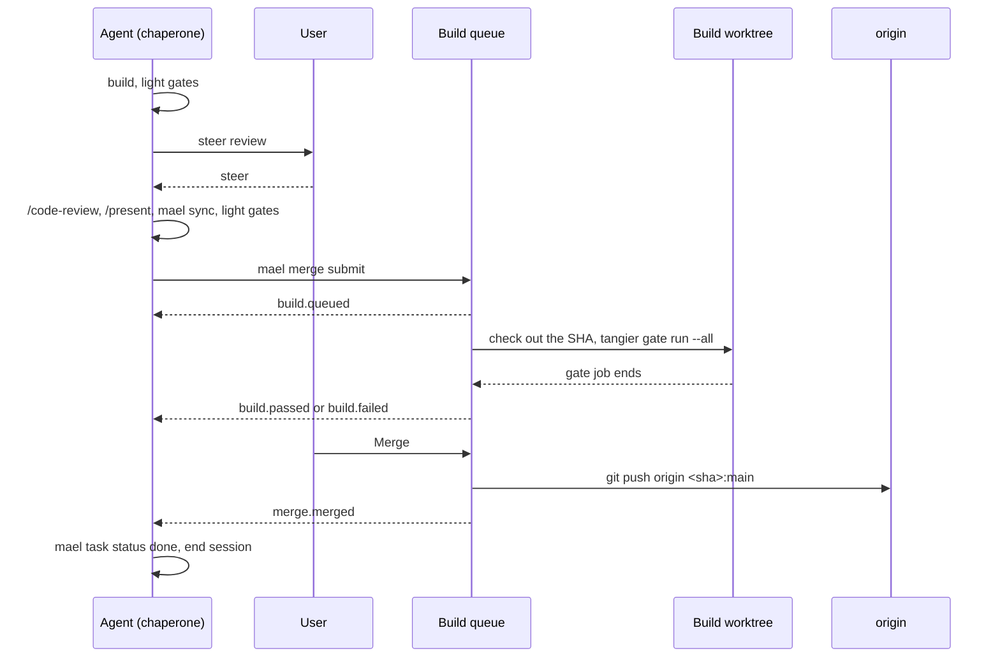

# The build queue

A project with `merge: local` in `.maelstrom.yaml` does not use pull requests. The agent submits
its branch head to the task's **Merge request**. Each submit starts a **Queue build**: the
orchestrator server's **Build queue** runs the full gates on the SHA in a **Build worktree**. The
user reviews a green Merge request and clicks Merge, and maelstrom fast-forwards `main` on origin
to it. GitHub stays a plain git remote.

[ADR 0004](../adr/0004-maelstrom-merges-through-a-local-build-queue.md) records the decisions
and the options rejected. This doc describes the mechanics that the chain after task q944
builds. A project with `merge: github`, the default, keeps the PR flow of [CI gates](ci.md).

## The flow

The flow has two human **Checkpoints** and one queue.

1. **Steer review.** After the `built` milestone, the agent runs the light gates and presents the
   branch for a rough steer. It waits for the user. Structure and behaviour change here, before
   review and present spend tokens on them.
2. **Submit.** After `/code-review` and `/present`, the agent runs `mael sync`, the light gates,
   and `mael merge submit`. The branch head goes to the task's Merge request.
3. **Build.** The queue checks out the SHA in a build worktree and runs the full gates. A
   failure goes back to the agent, which fixes the branch and submits again.
4. **Final review and merge.** A `passed` Merge request draws the Merge button. A click
   fast-forwards `main` to its SHA.

## Merge requests and Queue builds

Two records in the state database carry the work. The server is their one writer.

| Record | What it is | Lifetime | States |
| --- | --- | --- | --- |
| **Merge request** | The task branch's request to merge into `main`, as a PR is. Holds the head SHA and base of the last submit. | One per task branch, from the first submit to the merge. | `open`, `withdrawn`, `merged` |
| **Queue build** | One gate run of one SHA in a build worktree. The thing the queue schedules. | From queued to its end. | `queued`, `running`, `passed`, `failed`, `stale`, `cancelled` |

The code calls the Queue build `Build`, in `mael_domain/merge_request.py`.

### A submit updates the Merge request

`mael merge submit` refuses a dirty worktree, and a branch whose base is not the current
`origin/main` tip. The agent commits, then runs `mael sync` first. The command pushes the branch,
then sends the head SHA and its base to `PUT /api/tasks/{project}/{id}/merge-request`. The CLI
does the git work, because the server cannot see a worktree on a **Remote host**.

The first submit on a task opens its Merge request. Each later submit updates the SHA and base,
cancels the unfinished Queue build, and queues a new one. A `withdrawn` request reopens on the
next submit, as a withdrawn PR does. A `merged` request is final: a submit after it opens a new
one. `mael merge withdraw` withdraws the request and cancels its unfinished Queue build.

The request links its newest Queue build. Only that one counts: an older Queue build that ends
after a newer one is queued tells nothing and changes no status. The older Queue builds stay as
the request's history, each with its SHA and its result.

A commit after the submit does not change the Queue build: it gates the recorded SHA. The next
submit starts a new one.

`mael merge submit` sends `.drafts/pr.md` as the Merge request's description and leaves the
file in place. A submit with no file keeps the stored text. The Merge confirm shows it.

### The status

The status comes from the request and its linked Queue build. The node, the CLI and the Merge
button read it.

| Status      | Comes from                                       | Meaning                                         |
| ----------- | ------------------------------------------------ | ----------------------------------------------- |
| `queued`    | The linked Queue build is `queued`.              | Waits for a free build worktree.                |
| `building`  | The linked Queue build is `running`.             | Its steps or gate job run in a build worktree.  |
| `passed`    | The linked Queue build `passed`, and `main` is at its base. | Every gate passed. Merge is enabled.  |
| `stale`     | The linked Queue build is `stale`, or it `passed` and `main` moved. | `main` moved since the submit. Rebase and submit again. |
| `failed`    | The linked Queue build `failed`, or was cancelled outside the queue. | A step or a gate failed, or its gate job was cancelled. |
| `withdrawn` | The request.                                     | The agent withdrew it.                          |
| `merged`    | The request.                                     | `main` on origin is at its SHA, or contains it. |

The normal path is `queued → building → passed → merged`.

A `passed` request turns `stale` by derivation, and nothing stores the move. The queue keeps the
last `origin/main` tip each fetch saw, per project, in memory. A stored move would make the
restart re-tell send `build.rebase`, and only a click sends it. The queue fetches at the base
check, at the Merge's check and after a rejected push. At start, it fetches each project that
has an open `passed` request. A push to `main` from outside maelstrom shows at the next fetch.

### By example

The agent submits A; its Queue build fails. It fixes and submits B; the Queue build passes. The
user gives feedback; the agent submits C; the Queue build passes. The user merges.

| Thing | Lifetime in the example |
| --- | --- |
| Task branch `feat/x` | The only branch. Pushed at each submit, with `--force-with-lease`. |
| Merge request `mr1` | One, from submit A to the merge. Its SHA moves A → B → C. |
| Queue builds `b1` (A, failed), `b2` (B, passed), `b3` (C, passed) | Each from its submit to its gate job's end. They stay as `mr1`'s history. |
| Build worktree `_build1` | No branch. Detached at the last SHA it built, and reset before each Queue build. |
| Chaperone | From submit A to the merge, resumed for each event that finds it not live. |

When `main` moves before `b3` starts, `b3` ends `stale`. The agent syncs and submits D, and `b4`
becomes the linked Queue build of the same `mr1`.

## The chaperone

Every Merge request has a **Chaperone**: the live top-level agent of its task. The queue sends
it each `build.*` and `merge.*` event, and never changes the branch itself. All git work on the
branch stays with the agent.

When an event is due and no agent of the task is live, the server resumes the task's latest
exited top-level agent with the event as its first turn. With no agent at all, the event is
dropped, and the status still shows on the node. The task closes at merge, not at submit, so the
chaperone stays on the Merge request until `merge.merged`.

Each Queue build records, in `told`, the last state the chaperone heard. At start, the queue
tells the chaperone again of each linked Queue build whose `told` differs from its state. A
Merge request records `merged` in its own `told` when the chaperone hears `merge.merged`, and
the start tells it again until then. A crash between a transition and its tell loses nothing.

## Building

### The base check

A running Queue build is one **Operation**, kind `build`, from the slot claim to the gate job's
end. Its steps are `base`, `checkout`, `install` and `gates`, and its busy key
`build:<project>/<slot>` holds the slot. The Queue build keeps the result after the operation ends.

The `base` step fetches origin. When `origin/main` is not the submitted base, the queue does not
build. The Queue build ends `stale`, the queue sends `build.rebase`, and no gate runs. The agent
runs `mael sync`, resolves any conflict, runs the light gates, and submits again.

### No rebuild when `main` moves

A merge does not touch the other Merge requests: each `passed` one reads `stale` (see
[The status](#the-status)). Its Merge button reads "Rebase and rebuild", and a click sends
`build.rebase` to the chaperone. Only a Merge request that a human wants to merge now builds
again.

A `failed` Merge request reads "Rebuild". It queues a new Queue build of the same SHA, as
`mael merge retry` and the Retry of the failed `build` Operation do. The Retry refuses when a
newer Queue build replaced that one. A `stale` Queue build does not rebuild: its base check
would fail again.

Records keep a rebuild cheap. A gate whose gate scope content did not change is `verified` at
once.

### Each Merge request is gated alone

A Merge request is gated against `main`, not on top of the one before it. The queue sets no
merge order: a human picks it at the Merge button. ADR 0004 gives the reason.

### Build worktrees and slots

Each Queue build checks out its SHA in a build worktree from a pool: `_build1` … `_buildN`. A
build worktree is a detached checkout beside `_main`, made on first use. Like `_main`, it never
closes. It takes its `PORT_BASE` from the pool, keyed by its name, writes its own `.env`, and
runs the project's `install_cmd`.

Build worktrees are not in the world: `list_all` skips `_build*` folders, so Dismiss, recycle and
the NATO-name paths never see them.

`build_slots:` in `.maelstrom.yaml` sets N. The default is 2. Waiting Queue builds start oldest
first, and only a request's linked one starts. Tangier's machine-wide job slots (`max-running`,
default 4) still cap every gate job on the host, the agents' jobs included. Tangier runs one job
per worktree, so one Queue build per slot never waits inside tangier.

Before a Queue build, the queue resets the build worktree to the SHA: `git checkout --detach`,
`git reset --hard`, then `git clean -fd`. A failed build leaves nothing for the next one. It is
`-fd`, not `-fdx`, so the ignored `.env`, `.venv` and `node_modules` stay.

### Cancels and restarts

A new submit or a withdraw cancels the unfinished Queue build. A queued one ends at once. A
running one ends `cancelled` too, and the queue runs `tangier gate cancel --job <n>`. Its
operation ends at its next step. In the `gates` step, a cancel that tangier confirms ends it at
once: `tangier gate cancel` returns only after the job has stopped. When tangier does not confirm,
the operation waits for the job's end. The slot is free when the operation ends.

A linked Queue build whose gate job was cancelled outside the queue ends `cancelled`. The status
reads `failed`, and the chaperone hears `build.failed`: nothing runs it again until a submit.

At start, each `running` Queue build ends `cancelled` with detail "server restarted", and its
gate job is cancelled. A new `queued` Queue build of the same SHA becomes the request's linked
one. Records make the second run cheap. `queued` Queue builds stay queued.

A lost job end must not hold a slot for ever. A job can end before `tangier gate run` returns
its id; the queue keeps the last 64 job ends that no Queue build claimed, and claims one when the
id arrives. The Gate watch's snapshot after a reconnect reports a held job that ended. As a
backstop, every 15 min the queue asks `tangier gate status --json` about the job. An ended job
ends the Queue build from tangier's record. A job tangier no longer knows ends it `failed`, with
detail "gates: job end not seen". A status that tangier cannot give counts as still running.

The queue skips a project whose `.maelstrom.yaml` does not load, or no longer says
`merge: local`. Its queued Queue builds wait; the other projects run.

### The gates and their weights

`pipeline.toml` stays the one place that defines a gate. Gate sets name two weights:

| Weight | Command                               | Who runs it            | When                         |
| ------ | ------------------------------------- | ---------------------- | ---------------------------- |
| Light  | `tangier gate run @pre-merge --direct` | The agent              | Before steer review, submit  |
| Full   | `tangier gate run @merge`              | The build queue        | Each build                   |

`--direct` makes a gate needed only when its own gate scope paths change, not those of a gate it
`depends` on. The full set has the `depends` cascade and `e2e`.

The queue runs with `TANGIER_RUNNER_KIND=queue`, so its records have the `queue` kind. The trust
rules are the same as for CI:

- `lint`, `test`, `web` and `jig` accept any local pass record.
- `e2e` accepts only a record with `kind=queue`: `accept = "kind=queue"`.

The queue's gate jobs are normal tangier jobs. The **Gate watch** sees them and hands each job end
to the queue by job id. The queue runs `tangier gate run` without `--wait` and reads the job id
from its `job <n>:` line, so a slot holds no process. A build worktree has no node, so the running
Queue build's **Gate lozenge** shows on the Merge request's own worktree node, beside its status
chip.

Until tangier ships gate sets, the queue runs `tangier gate run --all`: every gate in
`pipeline.toml`, `e2e` included. `BUILD_GATE_ARGS` in `build_queue.py` holds it, and task q944.5
changes it to `@merge`. Tangier 0.3.5 does not read `TANGIER_RUNNER_KIND` yet, so its records
stay `local` until it does.

### The container runner

`[gate.<name>] container = "<image bucket>"` in `pipeline.toml` runs the gate's command in the
image of tangier's `[image.<bucket>]`, with the checkout mounted. A container isolates ports and
toolchains, so `e2e` can also run in an agent's worktree. Tangier owns the runner. Maelstrom's
own gates do not use it yet.

## Merging

The Merge button merges a `passed` Merge request. Its confirm shows the description. The click
posts the SHA the button drew, and the server refuses any other SHA, so a submit between the
view and the click cannot merge an ungated SHA. The click starts one **Operation**, kind
`merge`, with the busy key `merge:<project>`:

| Step     | What it does                                                                           |
| -------- | -------------------------------------------------------------------------------------- |
| `check`  | Fetch. Refuse "main moved" when the tip is not the base and does not contain the SHA.  |
| `push`   | Under the queue lock: check again, `git push origin <sha>:refs/heads/main` with no force, then record the request `merged`. |
| `branch` | Delete the branch on origin. The worktree keeps its local branch.                      |
| `main`   | Fetch and update `_main` with `update_local_main`.                                     |
| `tell`   | Send `merge.merged` to the chaperone.                                                  |

A `main` that already contains the SHA is a merge: the `push` step skips the push and records
`merged`. A rejected push is refused as "main moved", and the fetch after it makes the request
`stale`. Git rejects a push that is not a fast-forward, so a push to `main` from outside
maelstrom needs no lock on origin. The `push` step holds the queue lock, so no submit moves the
request between its check and the record. The push has a 60-second timeout. A push that fails
while `main` is still at the base is a fault. A push that git reports as failed, but that
origin took, is a merge.

The request is `merged` as soon as the push succeeds. A fault in `branch`, `main` or `tell`
does not lose the merge: the step ends `done` with the warning as its words.

After the push, the branch is in `main`, so `is_worktree_closed` and **Dismiss** need no change.

`mael git merge` in a `merge: local` project starts the same Merge. See
[`mael git merge`](../reference/cli.md#git-helpers).

## Events

| Source  | Type            | Sent when                                         |
| ------- | --------------- | ------------------------------------------------- |
| `build` | `build.queued`  | The queue accepts a submit.                       |
| `build` | `build.passed`  | Every gate passed.                                |
| `build` | `build.failed`  | A gate failed. It names the gate and the log.     |
| `build` | `build.rebase`  | The base check failed, or the user clicked "Rebase and rebuild". |
| `merge` | `merge.merged`  | The push to `main` succeeded.                     |

Each `build.*` and `merge.*` event has the attributes `task`, `merge-request`, `build`, `sha`
and `branch`. A `running` Queue build sends none. "Rebase and rebuild" sends `build.rebase` only
on a `stale` request. `merge.merged` tells the agent to close the task and end its session.

The user's review comments reach the chaperone as `orchestrator-ui` events.

## Landing

The `merged` **Landing step** of a `merge: local` task reads the queue's record in the state
database, not GitHub's data about a PR. `tracked_tasks` follows a task with a `merged` Merge
request as well as a task with a PR, and `TrackedTask.merged_at` holds the merge time.

`uat` and `live` come from the deploys that `deploy.environments` names, and the deploy check
needs a PR. So a `merge: local` task stops at `merged` until a deploy check keyed by the Merge
request exists.

## Remote hosts

The build queue runs on the server that owns the project's tasks: the **Parent server**. An agent
on a **Remote host** submits through the parent, because its task stays there:
`OrchestratorClient.for_tasks()` names it. `mael merge submit` pushes the branch to origin first,
so the parent's build worktree fetches it. The server tells only its own agents today, so a
remote chaperone may not hear `build.*` events yet. See [remote hosts](remote-hosts.md).

## Code the chain reuses

| Code                                                    | Use                                     |
| ------------------------------------------------------- | --------------------------------------- |
| `update_local_main`, `close_worktree`, `is_worktree_closed` (`worktree.py`) | `_main` after merge, Dismiss. |
| `merge_request.py`, `merge_request_store.py` (`mael_domain`) | The two records, their moves, their status. |
| `build_queue.py` (`mael_orchestrator`)                   | The queue, the slots, each Queue build. |
| `merge_cli.py` (`mael_cli`)                              | `mael merge submit`, `status`, `withdraw`, `retry`. |
| `build_event`, `merge_event`, `rebase_event` (`mael_domain/external_event.py`) | The `build.*` and `merge.*` events. |
| `gate_source.py`, `gate_table.py` (`mael_orchestrator`)  | The Gate watch.                         |
| `operations.py` (`mael_domain`, `mael_orchestrator`)     | Each build and each merge.              |
| `landing.py`, `landing_github.py`                        | Landing `merged` from the queue.        |
| `MergeControl.tsx` (`orchestrator-ui/src/worktrees/`)    | Merge, "Rebase and rebuild" and "Rebuild". |

## Risks to test

Each task's plan writes its own test plan. These risks need cover:

- Two queues push to `main` for one project at the same time.
- A submit of a branch that is not based on the `main` tip.
- `main` moves between submit and build.
- `main` moves between `passed` and Merge.
- The agent commits after submit.
- An event is due and the chaperone is not live.
- A failed gate leaves the build worktree dirty.
- More Queue builds than build slots.
- The server restarts during a build.
