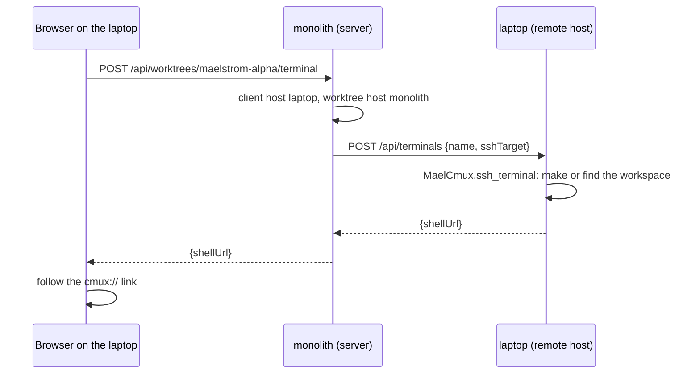

# The cmux package

How maelstrom drives cmux from code. For the shell-level `cmux` CLI — opening a browser pane,
sending a command to a terminal — use the `cmux` skill instead.

Maelstrom uses cmux for three things only:

- The orchestrator's `cmux` link makes a worktree's workspace with one terminal, or links to the
  terminal it has. For a **Remote client**, that terminal is an SSH shell in the remote host's
  cmux; see [Remote clients](#remote-clients).
- The orchestrator's world shows each worktree's terminal link.
- Closing or trashing a worktree closes its workspace.

`lib/domain/src/mael_domain/cmux/` has three layers. Each layer calls only the one below it.

| Layer | File | What it holds |
|---|---|---|
| Transport | `client.py` | `CmuxClient.run(*args) -> CmuxResult`, `SubprocessCmuxClient`, `current_client`, and the timeout. |
| API | `api.py` | `CmuxApi`: one typed method per cmux command. `CliCmuxApi` builds the argv and parses the reply. `FakeCmux` is the in-memory cmux. |
| Policy | `mael_layout.py` | `MaelCmux` and `WorktreeWorkspace`: the workspace names and the three uses. |

The API knows no maelstrom concepts. Only the policy layer knows the `{project}-{worktree}`
name. The orchestrator and the worktree close and trash steps use the policy layer.

## The API

`CliCmuxApi` reads with `--json --id-format both`. The reply gives each entity a ref, such as
`pane:3`, and a UUID. A command takes the ref. A deep link names the UUID. No reply text is
parsed with a regex.

Writes keep their text replies. `CmuxResult.ok` and `CmuxResult.ref()` parse them. A failed
command gives `[]`, `None` or `False`, and never raises.

## The fake

Every cmux test uses `FakeCmux`. It holds workspaces, then panes, then tabs, and answers every
`CmuxApi` method from that state. Tests assert the resulting state, not the argv:

```python
cmux = FakeCmux()
url = MaelCmux(cmux).worktree("myproject", "alpha", "/wt").ensure_terminal()
assert cmux.tabs("myproject-alpha") == [["Terminal"]]
assert url == cmux.pane_link("myproject-alpha", 0)
```

A new workspace starts with one terminal, as in real cmux. `commands` logs the command each new
workspace's terminal ran. `tabs` and `pane_link` read the state back. The suites get a
`fake_cmux` fixture that makes `MaelCmux.current()` answer over one.

`RecordingCmuxClient` remains for the API's own parsing tests in `test_cmux_api.py`.

## Outside cmux

`MaelCmux.current()` returns `None` when no cmux app answers on the socket. A call site checks
for `None` once. After that, every method degrades silently. With cmux down, the orchestrator refuses the terminal command with "cmux could not make the
terminal".

`current()` does not tell you the caller is in cmux. The socket path falls back to
`~/.local/state/cmux/cmux.sock`, so every process on the machine reaches a running app.

The agent daemon removes the `CMUX_` variables of its own pane from its agents' environment. It
keeps `CMUX_SOCKET_PATH` and `CMUX_SOCKET_PASSWORD`, which say where cmux listens.

## Terminal links

cmux 0.64 and later open `cmux://workspace/<workspace uuid>/pane/<pane uuid>` links. The link
focuses a pane that is already open. It cannot make one.

A worktree's terminal link names the pane of the **first terminal tab** in its workspace, in
`list-panels` order. In a workspace that the orchestrator made, that is its one terminal. In a
workspace the user laid out, the link still lands on a terminal in the worktree.

`MaelCmux.terminal_urls` gives the orchestrator's world each worktree's terminal link. It runs
one `list-workspaces`, then one `list-panels` for each matched workspace.
`WorktreeWorkspace.ensure_terminal` returns the link. When the workspace is missing, it first
makes one with one terminal tab in the worktree. The terminal runs only its `cd`.

`list-workspaces` and `list-panels` may list only the current cmux window. A worktree workspace
in another window then has no link.

## Remote clients

The cmux control opens a terminal only in a cmux the browser can see: the cmux of the browser's
own machine. Two hosts decide what it does:

- The **client host**: the host the browser is on. The server finds it from IP addresses.
- The **worktree host**: the host that owns the worktree, from the id prefix.

Each is a host name. The server's own name is its id prefix, `""` without `host_name:`.

| Client host | How the server knows |
|---|---|
| This server | The peer IP is loopback, or it is the server's own address on that socket. |
| A **Remote host** (a **Remote client**) | The peer IP is an address that a `hosts:` URL resolves to, and that host is online. |
| None | Neither. The UI shows no control. |

The installed orchestrator listens directly on `127.0.0.1` and on the dev host's addresses, with
no proxy, so the peer IP is the browser's. The browser names no host, so it cannot make the
server call a machine outside `hosts:`. `RemoteHost.addresses` keeps each resolved set for 60 s,
so a changed tailnet IP is seen without a restart. `GET /api/client` answers
`{"local": bool, "host": str}`, with `host` the client host, `""` for none.

`POST /api/worktrees/{id}/terminal` is never forwarded to the worktree's owner, because the owner
would see the server as the client. The route puts `clientHost` and `worktreeHost` in the
`worktree.createTerminal` command:

| Client host | Worktree host | Terminal | Link |
|---|---|---|---|
| This server | This server | A local `cd` terminal here | Into the row and the reply |
| Remote host A | Remote host A | A local `cd` terminal on A: `POST /api/terminals {worktreeId}` to A | A writes its row; the merge brings it |
| This server | Remote host B | An SSH shell here, to B's row's SSH target | The reply only |
| Remote host A | This server, or remote host B | An SSH shell on A: `POST /api/terminals {name, sshTarget}` to A | The reply only |

Each worktree row carries its **SSH target**, `user@host:/path`. The user is the user the
orchestrator runs as, and the host is `dev_host:`. With no `dev_host:`, no other machine reaches
the server, so `sshTarget` is `""`. A merged row carries its remote host's target.



`POST /api/terminals` takes either a worktree id of the host's own, or a workspace name and a
target. It never takes a command. It refuses a target that `SshTarget.parse` refuses, and a name
`{project}-{nato}` with a character outside `[A-Za-z0-9._-]`. The host builds the command itself
with `SshTarget.command()`: `ssh -t user@host 'cd <path> && exec "$SHELL" -l'`, quoted for both
shells. So a caller can only make it open an `ssh` to one user, host and path, or a `cd` terminal
in one of its own worktrees.

An SSH workspace is named `{project}-{worktree}@{first label of the SSH host}`, such as
`maelstrom-alpha@monolith`. The laptop can then keep its own `maelstrom-alpha`. An IP host stays
whole, because every tailnet IP starts `100.`. The host that runs cmux builds the name from the
target, so a second click for the same worktree finds the workspace and focuses the same pane.

The link of an SSH terminal goes only into the reply, not into the world row. The world is shared
by every client, and the row's link names a pane on the worktree's own host. For the same reason,
the UI does not write it into its cached row, and shows the row's `shellUrl` only to a browser on
the worktree's host.

The refusals:

| Case | Code | Message |
|---|---|---|
| The worktree's host has no `dev_host:` | `invalid` | "Set dev_host on …" |
| The SSH target does not parse | `invalid` | "The SSH target … is not user@host:/path" |
| The client's remote host is offline or fails | `unreachable` | The remote host's words |
| The client host is none | `invalid` | "Open cmux from this machine, or from a remote host of this server." |
| cmux does not answer | `invalid` | "cmux could not make the terminal" |

A dev environment's UI is served through Vite's proxy, so every client of it reads as local.

## Timeouts

Every command times out after `COMMAND_TIMEOUT_SECONDS` (10 s) and reads as no answer. A
failure to run the binary also reads as no answer.
