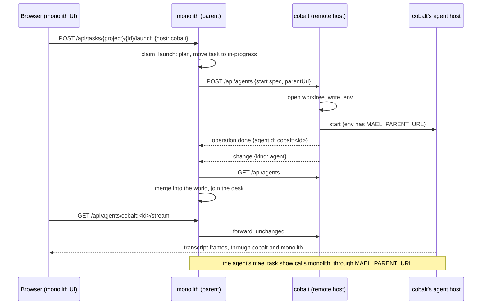

# Remote hosts

One orchestrator server can launch a task on a second machine. The first server (monolith) is
the **Parent server**. The second (cobalt) is a **Remote host**: a normal orchestrator server with its own
UI, tasks and agents. The parent **delegates** the launch. The remote host runs the agent with its
normal models, on its own disk. The agent's task stays on the parent. This raises agent capacity
past what one machine allows.

The parent merges the remote host's world into its own world. A request for an id that the remote
host owns goes to the remote host's normal route, unchanged. So the UI follows, approves, says to
and stops a remote agent as it does a local one. Claude and Codex agents both work.

## Delegation

A delegated launch has two parts:

1. **The parent claims the task.** `TaskSource.claim_launch` stores a Claude session id when the
   task has none, plans the launch, checks the execute model and moves the task to in-progress. It returns a `LaunchClaim`: the project, the task id,
   the previous status and the `LaunchPlan`.
2. **The remote host starts the agent.** The parent's `start_on_host` step posts a start spec to
   the remote host's `POST /api/agents`. It waits for the remote host's operation to end, and
   takes the agent id and the worktree id from it. Then the parent calls `TaskSource.started`
   with that agent id, so a Codex task stores its thread id. A never-run Codex task sends an
   empty `session`.

The start spec holds `project`, `branch`, `prompt`, `mode`, `model`, `executeModel`,
`session`, `env`, `taskId` and `parentUrl`. A free agent posts the same route with fewer fields.
A free agent's start has no `parentUrl`, so it cannot name a `session`, `env` or `taskId`. Only a
delegated start can: without a parent, a `session` would resume a task's agent past the claim.

The remote host runs the one agent start that each server uses (`_agent_start_steps` in
`server.py`): check that no live agent holds the session, open the worktree, check that it is
synced, write the `.env`, start. A local launch runs its claim, then the same steps. When the
start fails, the server that claimed the task calls `rollback(claim)`. The task goes back to its
previous status.

A delegated launch that loses its wait for the host's operation keeps the claim, and the task
stays in progress: the host can still start the agent. Only a host operation that ends refused
or failed rolls the claim back.

The parent refuses the launch when the host is not in `hosts:`, when it is offline, or when the
parent has no `orchestrator_url` to give as `parentUrl`.

## The per-launch parent

The parent is a fact about one agent, not about the remote host's server. So one server can run
agents for several parents and its own direct agents at the same time. Config goes one way: only
the parent's `hosts:` names the remote host.

The `DaemonRouter` removes `parentUrl` and `taskId` from the start payload before the daemon sees
it. It keeps them on the Agent record as `parent_url` and `task_id`. A restart keeps both. Only a
**Delegated agent**'s record has a `parent_url`.

The remote host adds `MAEL_PARENT_URL` to the agent's env. The spec's `env` comes from the
parent's `plan_launch`, and already holds `MAEL_TASK_ID`, `MAEL_TASK_PARENT` and
`MAEL_TASK_PROJECT`.

On the remote host, a delegated agent differs from a direct agent in three ways:

- Its `taskId` comes from its record, not from the session join.
- It does not join the remote host's desk, and the remote host's PR watch does not follow it.
  The parent's desk and PR watch do.
- Its documents are not attached to its task. No attachment crosses hosts yet.

## The task seam and `TaskHomes`

`TaskSource` holds only task work. The worktree half of a start is in `WorktreeOpener`
(`sources.py`): the open with its per-project lock and executor, `write_env`, `has_transcript` and
`live_sessions`. A free agent, a task launch and a delegated agent all open through it.

The calls the server makes for one agent go through a narrow `TaskHome` protocol:

| Method | Server caller | `RemoteTaskSource` route on the parent |
|---|---|---|
| `read_some` | `_task_of`, `_planning_task` | `GET /api/tasks/{project}/{id}` |
| `promote` | the task-set approve | `POST /api/tasks/promote` |
| `register_pr` | the `gh-pr` link | `PUT /api/tasks/{project}/{id}/pr` |
| `withdraw_pr` | the `gh-pr` link | `DELETE /api/tasks/{project}/{id}/pr` |
| `create` | the reopen task of a Shelve | `POST /api/tasks` |

`NotebookTaskSource` and `RemoteTaskSource` both satisfy `TaskHome`.
`TaskHomes.for_parent(parent_url)` chooses one. An empty URL gives the local notebook. Any other
URL gives the one `RemoteTaskSource` for that URL, with a lazy aiohttp session.
`Orchestrator._home(agent)` calls it with the agent's `parentUrl` when the agent is delegated.

A worktree has a **Task home** too. `Orchestrator._worktree_home(worktree_id)` gives the home of
the newest delegated agent in the worktree, or the local notebook when there is none. A Shelve
writes its reopen task there: the server passes the home to the `force_close` port.

When the parent does not answer, `RemoteTaskSource` raises `TaskSourceRemote` ("Tasks for this
agent are on <url>"). The server replies with the code `unreachable` (HTTP 502).

## The id prefix

`host_name: cobalt` names a server. Its name is its **Id prefix**: the server makes each agent,
worktree, gate job and operation id as `cobalt:<bare id>`. With no `host_name`, ids are bare. A name matches
`[a-z0-9][a-z0-9-]*`. It holds no `.`, because the UI splits subagent ids on `.`.

`IdSpace(prefix)` (`lib/agent/src/mael_agent/host_ids.py`) owns the rule:

| Method | Does |
|---|---|
| `own(bare)` | Adds the prefix. The empty prefix changes nothing. |
| `strip(id)` | Removes this space's prefix. Another prefix stays. |
| `owner(id)` | The host before the `:`, or `""`. A part before `:` that is not a valid name is not an owner. |
| `resolve(id)` | Reads an id with no owner as one of this space's ids. |
| `is_own(id)` | Whether this space made the id. |

`build_orchestrator` makes the `IdSpace` from `host_name`. The Orchestrator, the `DaemonRouter`,
the world builders and the gate watch get the value. They do not read config.

Where the prefix goes on:

- **Agents: at the `DaemonRouter`.** Each id that comes in from a daemon gets the prefix: a row's
  `id` and `parent`, a start or resume reply, and `agent.id` in `AGENT_DETAIL`. Each id that goes
  out loses it. Records are stored prefixed. The Claude daemon, the spec files, the Codex adapter
  and its thread ids keep bare ids, and `codex.restore` gets bare ids.
- **Items, files, milestones and attention:** built from the agent id, so they carry the prefix
  with no extra step.
- **Worktrees: in the server's worktree refresh.** `worktree_entity` stays bare.
- **Gate jobs: in `gate_job_entity`**, which takes the `IdSpace`.
- **Operations: in `OperationRunner.begin`**, which mints `cobalt:op<n>`.

`agent_entity.host` is the owner of the agent id.

The worktree and agent routes read `match_info["id"]` through `ids.resolve`. So a CLI that sends a
bare id, such as `mael close`, still reaches `cobalt:maelstrom-alpha`.

When a server with live agents gets a `host_name`, the bare-id records retire. The next list
adopts the same agents again under prefixed ids.

### Names the UI shows

The `host` entity carries `name` and `idPrefix`. `idPrefix` is `IdSpace.prefix`. `name` is
`GlobalConfig.server_name()`: `host_name`, else the first DNS label of a named `dev_host`, else
the machine's host name up to the first `.`.

The UI names a worktree `<owner>:<nato>` when its id has an owner other than its own `idPrefix`,
and `nato` otherwise (`worktreeName` in `selectors/worktrees.ts`). A bare id names no other owner,
so it reads as this server's. So monolith shows cobalt's bravo as `cobalt:bravo`, and its own
bravo as `bravo`.

On the remote host, the **Worktree box** and the worktree area of a worktree that a live
**Delegated agent** uses say `· in use by <parent>` (`usedByParent`). The parent's name is the first DNS label of the agent's `parentUrl`. The
parent makes that URL from its `dev_host`, so this agrees with the parent's own `name` unless the
parent sets a `host_name` that differs from its `dev_host` label.

## Merge and dispatch at the handler layer

### Merge

The parent merges the remote host's whole world. `RemoteHost` (`remote_hosts.py`) holds one slice
for each merged kind:

| Kind | List route on the remote host | Owner |
|---|---|---|
| `agent` | `GET /api/agents` | id prefix |
| `document` | `GET /api/documents` | prefix of `agentId` |
| `attention` | `GET /api/attention` | prefix of `agentId` |
| `worktree` | `GET /api/worktrees` | id prefix |
| `gateJob` | `GET /api/gate-jobs` | id prefix |
| `operation` | `GET /api/operations?limit=200` | id prefix |

A document or an attention item belongs to its agent. Its own id need not start with the prefix:
an attention id is `att-<item id>`.

`RemoteHost.run` holds the remote host's `GET /api/events` stream open. A `reset` sets the host
online and reads every kind again. A `change` reads its kind again. `Orchestrator._remote_changed`
diffs each list against the host's slice, not against the world, and applies the result through
`_apply`. The parent's own refreshers diff only the ids with the parent's own prefix. So a local
refresh never removes a merged row, and a merge never removes a local one.

Other rules of the merge:

- The `reset` body carries `idPrefix`. When it is not the `hosts:` key, the host stays offline
  and the parent logs once. Its ids would not route back to it.
- Only rows the host owns merge. A host's merged rows from a host of its own do not.
- A worktree merges only when the parent has its project.
- Merged documents are list rows, with no detail fields. The detail comes through the forward.
- `_merged_agent` clears `taskId` on an agent whose `parentUrl` is not the parent's own URL.
  That task id names a task in another notebook, and the parent can hold a task with the same
  id.
- `_merged_operation` applies the same rule to an operation, through the operation's agent.
- The operations are read in the UI's window of 200. An older host operation leaves the
  parent's world, as it leaves the UI's view.

The link reconnects with backoff from 1 s to 30 s. A stream silent for 40 s counts as dropped,
because each server pings every 15 s.

### Offline is not dead

An offline host keeps its slices. Its agents and worktrees keep their last state, with an
`offline` mark on the host. The parent exits none of them. A host that sleeps must not lose its
agents. When the link comes back, the `reset` reads every kind again.

### Dispatch

One aiohttp middleware in `routes.py`, `_host_owned`, sends each request for a host-owned id to
that host. Its table, `HOST_OWNED_ROUTES`, covers each route at or under:

- `/api/agents/{id}`, with the `/stream` WebSocket;
- `/api/documents/{id}`;
- `/api/files/{id}`;
- `/api/operations/{id}`, so the log, Seen and Retry of a host operation go to the host;
- `/api/worktrees/{id}`.

When `match_info["id"]` has an owner in `hosts:`, `RemoteHost.forward` sends the method, path,
query and body unchanged, and streams the reply back. A WebSocket is joined frame for frame. An
offline host answers `unreachable` at once. Desk ids (`agent:cobalt:x`) are never read for a host.

A forwarded command answers with the host's operation id. The merge brings that operation to
the parent, so the parent's console and cards show it like a local one.

The parent's own steps also use the host's routes:

| Step | Host route | Ends when |
|---|---|---|
| `_ask_host`, behind `_relay` and `_tell` | `POST /api/agents/{id}/say` | the host answers |
| `_stop_remote`, the stop of a Terminate, a PR watch or a desk dismiss | `POST /api/agents/{id}/stop` | the host's operation ends |
| `_end_on_host`, the worktree end of a desk dismiss | `POST /api/worktrees/{id}/close`, `/force-close` or `/trash`, or `DELETE /api/worktrees/{id}` | the host's operation ends |

A step that waits uses `RemoteHost.await_operation`. A host operation that ends refused or
failed refuses the parent's step with the host's words. A wait that loses the host refuses the
step too, so the parent's operation does not hang. The remote host exits the agent or closes the
worktree, and the merge brings the change to the parent.

`_worktree_plan` refuses a worktree id with another owner. A merged row holds the host's paths,
so git must never run on them on the parent. Validation refuses a worktree command on an offline
host with `unreachable`.

### What the forward covers

Each worktree feature runs on the worktree's host, against its own disk, git, `gh` and language
server: the Changes tab (`changes`, `diff`, `file`, `tree`, `excerpt`, `raw`, `definition`,
`comments`), Close, Shelve, Trash, Delete, Sync, Merge, Auto-merge, Env, and the Live feedback
params route. See [live-feedback.md](live-feedback.md) for the jig's socket.

A dev env URL is built from the host's `dev_host`. See
[Remote hosts](../reference/configuration.md#remote-hosts).

### Terminals for a remote client

A browser on a remote host is a **Remote client** of the parent. The parent matches the browser's
peer IP against each online host's resolved addresses (`Orchestrator.client_host`).
`/api/worktrees/{id}/terminal` is the one route under `HOST_OWNED_ROUTES` the parent answers
itself (`ANSWERED_HERE`): forwarded, the owner would see the parent as the client. The parent
calls `POST /api/terminals` on the client's host, or opens the terminal itself. See
[Remote clients](cmux.md#remote-clients).

## The CLI's two targets

A delegated agent's `mael` sends task commands to its parent, through `MAEL_PARENT_URL`, and
everything else to its own server. A command that still uses the local state database refuses.
See [cli-over-api.md](cli-over-api.md#the-two-targets).

## Same origin, no CORS

The browser talks to one origin: the parent. The parent forwards each remote request, so the
remote host needs no CORS headers.

Each server refuses a state-changing `/api` request (not `GET`, `HEAD` or `OPTIONS`) whose
`Origin` is not its own. The reply code is `forbidden` (HTTP 403). The scheme is not compared,
because the UI's dev server serves HTTPS and proxies to the server over HTTP. A request with no
`Origin` passes: the CLI sends none, and the forward removes it. This protects a remote host that
serves its own UI from a page on another site.

## The merged desk

The parent's desk is one view of every agent it can see: its own, its delegated agents, the
remote host's direct agents, and the agents of other parents on that host.

- A new merged top-level agent joins the desk through `_join_desk`. One whose `taskId` names one of
  the parent's tasks goes on as `task:`, and the PR watch follows it. Any other goes on as `agent:`.
- A delegated launch puts `task:<id>` on the parent's desk when it starts.
- The UI chooses the Launch default. It is the host of the newest agent in the world with the
  task's `taskId`, when that host is online. Launch shows only when the task has
  no agent, so in practice the default is local.

A per-host view would be a filter on this desk. It is not built.

## Room for auth

The tailnet is the only auth today. Bearer-token auth is planned. Each cross-host call goes
through one of two client sessions, so a token goes on that session's headers:

| Direction | Session | Where a token goes |
|---|---|---|
| Parent to remote host | `RemoteHost.session()` | `hosts:` accepts `name: {url: <url>}`, which has room for a `token` beside `url`. |
| Remote host to parent | `RemoteTaskSource.session()` | A per-launch token beside `parentUrl` in the start spec, and beside `MAEL_PARENT_URL` in the agent's env. The remote host then stores no long-lived key for the parent. |

The forward removes the browser's `Authorization`, `Cookie`, `Origin` and `Referer`.

## Not covered

- A host that the parent's config does not name. There is no registration.
- Moving a task between hosts. A session started on another host is a new session.
- Capacity scheduling, such as choosing the less busy host.
- The remote host's own setup: `gh` auth, git identity, Codex and Claude login, and project
  checkouts. `mael self setup` and `check-host` cover these.
